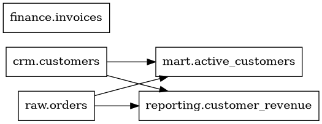
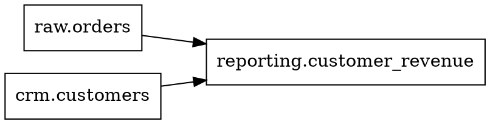

# sql-lineage-rs

**Educational Rust CLI that extracts table-level SQL dependencies and exports JSON or Graphviz DOT.**



This project demonstrates Rust fundamentals through a data engineering use case: parsing metadata about SQL queries to map which source tables feed a view or a materialized dataset. It is a small *prototype*, not a production SQL parser or a replacement for OpenAudit.

## Features

- Read SQL from a file or standard input.
- Tokenize words, identifiers, comments, quoted strings and punctuation without confusing `FROM` inside text with a SQL keyword.
- Detect dependencies from `FROM` and `JOIN`, with schema-qualified names.
- Recognize `SELECT`, `INSERT INTO ... SELECT`, `CREATE VIEW ... AS SELECT`, `CREATE TABLE ... AS SELECT`.
- Handle simple top-level `WITH` CTEs without treating a CTE alias as a physical table.
- Export readable terminal output, JSON, or Graphviz DOT.
- Unit tests for supported cases and input failures.
- **No external Rust dependencies.**

## Requirements

- Rust toolchain + Cargo. Install from the official Rust installer: https://rustup.rs/
- Graphviz only if you want to generate a PNG/SVG graph from the DOT output.

## Run

```bash
cargo test
cargo run -- --format text examples/demo.sql
cargo run -- --format json examples/demo.sql
cargo run -- --format dot examples/demo.sql > lineage.dot
```

Optional graph rendering (Graphviz installed):

```bash
dot -Tsvg lineage.dot -o lineage.svg
```

Windows PowerShell:

```powershell
cargo test
cargo run -- --format text .\examples\demo.sql
cargo run -- --format dot .\examples\demo.sql | Out-File -Encoding utf8 lineage.dot
```

## Sample DOT



## Architecture

- `src/lib.rs`: lexer, limited statement recognition, dependency extraction, JSON and DOT exporters, unit tests.
- `src/main.rs`: argument handling, file/stdin reading, errors and CLI outputs.
- `examples/demo.sql`: real-world-inspired SQL examples.

## Scope and important limitations

This is a **table-level heuristic**, not a SQL grammar-complete parser. It does not correctly support every SQL dialect or statement. In particular:

- Comma-style joins (`FROM a, b`) are not currently analyzed fully; prefer explicit `JOIN` for examples.
- Complex `WITH` constructs, recursive SQL, `MERGE`, `UPDATE`, `DELETE`, non-SELECT `INSERT`, and dynamic SQL are not supported.
- It does not derive column-level lineage, aliases, computed-column expressions, query semantics, or resolve schemas using a live database catalog.
- It scans nested query `FROM`/`JOIN` keywords to find tables, rather than building a real AST.
- It normalizes identifiers to lowercase, including quoted names; a full parser must preserve case semantics.
- Some exotic SQL syntax may produce incomplete results. **Never use it to automate a production migration.**

## Next steps

1. Replace the heuristic with an actual SQL AST parser, using the Rust `sqlparser` crate.
2. Add dialect-specific test fixtures (Snowflake, DuckDB, PostgreSQL).
3. Build column-level lineage and source code positions.
4. Add Graphviz diagrams to the README and publish test results from CI.
5. Benchmark processing time and memory on thousands of queries.

## Portfolio description (only after you have run and verified it)

> **SQL Lineage CLI (Rust)** — Prototype d'analyse statique de dépendances de tables SQL. Tokenisation, extraction de sources `FROM/JOIN`, prise en compte de CTE simples, exports JSON/Graphviz et tests unitaires, sans dépendances externes. Périmètre volontairement limité aux requêtes supportées.
